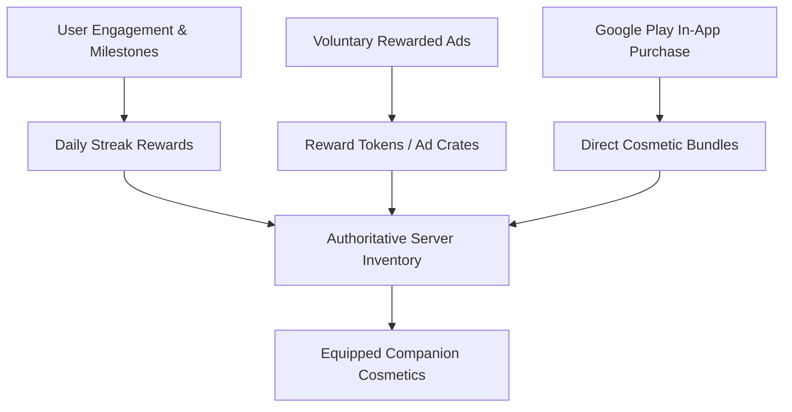

# GETFLOW — ADS & INTERACTIVE COMPANION SYSTEM ROADMAP
**Status:** DESIGN & ARCHITECTURAL PROPOSAL — UNDER DESIGN GATE (AWAITING OWNER APPROVAL)  
**Date:** October 17, 2026  
**Reference Design Guidelines Consulted:** `apple-design` & `swiftui-design-skill` (adapted to Android native gestures, restrained lime #CCFF00 accents, dark #090C0E visual identity).

---

## 1. COMPANION PROFILE SYSTEM (TASK H)

### A. Core UX & Preservation Principle
- **Strict Visual Freeze:** The approved Home screen, Runner Sphere, and Sprout pixel avatar in the header remain 100% UNTOUCHED.
- **Interaction Model:** Tapping the existing Sprout companion on Home triggers an accessible, spring-animated modal presentation (BottomSheet or dedicated push view) rather than a full-screen layout upheaval.
- **Privacy Guarantee:** The companion profile contains NO sensitive medical, biometric, or personal health records. It is strictly an engagement and progress reflection.

### B. Visual Structure & Specification (Apple HIG / SwiftUI Craft Adapted)
1. **Header Cluster:**
   - Active Companion Showcase: Scaled pixel-art canvas of the current companion with equipped accessories.
   - Name & Title Badge: Customizable display nickname (e.g., "Sprout • Sproutlet Lv. 4").
   - Close/Dismiss: Standard top-right tactile button.
2. **Progression Meter (Persistent Authoritative XP):**
   - Level indicator with segmented progress bar.
   - XP gained through genuine health actions:
     - Logging a verified meal: +25 XP
     - Completing daily calorie target within ±10%: +50 XP
     - Hitting daily step goal: +50 XP
     - Completing a logged workout: +75 XP
   - Formula: $\text{XP required for Level } n = 100 \times n^{1.5}$.
3. **Streak Integration:**
   - Visual flame counter linked to authoritative server calendar day.
   - Milestone badges (Day 3, Day 7, Day 14, Day 30, Day 100).
4. **Accessory & Cosmetic Wardrobe:**
   - Grid of collectible slots: Headwear (Caps, Headbands), Eyewear (Sunglasses, Monocles), Handheld/Aura (Water bottle, Dumbbell, Flow aura).
   - Equipping is instantaneous with optimistic local UI and background Supabase sync.
5. **Collection Vault Preview (Future Multiple Companions):**
   - Horizontal carousel displaying owned and silhouette unowned companions.

---

## 2. COMPANION ECONOMY (TASK I)

The economy is strictly aesthetic and cosmetic. There is ZERO pay-to-win mechanism, NO nutritional shortcut, and NO cash redemption or real-world monetary value.



### A. Voluntary Rewarded Ads
- **Zero Coercion:** Ad viewing is 100% voluntary. Never required to access core nutrition logging, analytics, or workout tools.
- **Format:** Google AdMob Rewarded Video (`/3566028223`).
- **Cryptographic Security:** Signed Google Server-Side Verification (SSV) callback verified on Render backend (`/rewarded/verify`).
- **Anti-Fraud & Throttling:**
  - Maximum 3 rewarded ads per calendar day.
  - 5-minute cooldown between voluntary ad completions.
  - Fail-safe no-fill handling: If AdMob returns no-fill, the user is politely notified without penalty.

### B. Google Play Purchases
- **Billing Provider:** Google Play Billing (`expo-iap`).
- **Product Types:** One-time non-consumable cosmetic unlocks (e.g., `cosmetic_pack_summer_2026`).
- **Server Verification:** Google Play purchase tokens are validated server-side via `google-auth-library` and Android Publisher API before granting entitlement.
- **Restore Capability:** `restorePurchases()` restores all cosmetic ownership across devices.

### C. Streak Rewards
- **Eligibility:** Free cosmetic grants awarded exclusively for consistent, healthy habits.
- **Server Authority:** Computed on PostgreSQL via daily UTC timezone day transitions, preventing local system clock tampering.
- **Fairness:** Missing a day does not penalize existing cosmetics. No deceptive "pay-to-restore-streak" mechanics.

---

## 3. MULTIPLE COLLECTIBLE COMPANIONS (TASK J)

### Species Catalog Proposal
1. **Sprout (Default):** The beloved plant pixel companion, representing natural nourishment and vitality.
2. **Blaze:** A fire sprite companion, representing metabolic energy and workout intensity.
3. **Tide:** A water droplet companion, representing hydration and muscular recovery.
4. **Pebble:** A resilient stone companion, representing progressive overload and strength foundation.

### Technical Architecture
- **Database Schema:**
  - `user_companions`: `(user_id, companion_id, is_active, level, xp, unlocked_at)`
  - `user_accessories`: `(user_id, accessory_id, companion_id, is_equipped, unlocked_via, created_at)`
  - `companion_catalog`: Read-only metadata catalog cached client-side.
- **Migration & Offline Grace:**
  - Default row created for Sprout during account onboarding.
  - MMKV cache holds active equipped state for instant rendering on Home without network latency.

---

## 4. FIELD REPORT VALUES

```text
ADMOB_ACCOUNT_STATUS: APPROVED
ADMOB_APP_READINESS: PENDING_GOOGLE_PLAY_STORE_LINK
ADMOB_POLICY_CENTER: CLEAN_ZERO_VIOLATIONS
ADMOB_ROOT_CAUSE: HARDCODED_PLACEHOLDER_APP_ID_IN_ANDROID_MANIFEST (ca-app-pub-1234567890123456~1234567890) CAUSED UMP HTTP 400 REJECTION
TEST_AD_LOAD: CONFIGURED_VIA_TEST_DEVICE_IDENTIFIERS
REWARDED_AD_TEST: READY_FOR_DEVICE_VALIDATION (Unit: ca-app-pub-5202280855139508/3566028223)
SSV_VERIFICATION: BACKEND_CRYPTO_VERIFIED (Render SSV Endpoint)
PRODUCTION_AD_SERVING_STATUS: BLOCKED_BY_APP_STORE_LINKING_UNTIL_PLAY_RELEASE

COMPANION_PROFILE_DESIGN: COMPACT_MODAL_SHEET_PRESERVING_FROZEN_UI
COMPANION_XP_MODEL: LOGGED_ACTIONS_POWER_FORMULA (100 * n^1.5)
ACCESSORY_SYSTEM: HEADWEAR_EYEWEAR_AURA_SLOTS
REWARDED_COSMETICS: VOLUNTARY_SSV_VERIFIED_DAILY_CAP_3
PLAY_BILLING_PRODUCTS: GOOGLE_PLAY_NON_CONSUMABLE_COSMETICS
STREAK_REWARDS: FREE_HABIT_MILESTONES (7/14/30/100_DAYS)
MULTIPLE_COMPANIONS: SPROUT_BLAZE_TIDE_PEBBLE (Sprout Default)
OWNER_APPROVAL_REQUIRED: YES — FEATURE_BEHIND_DESIGN_GATE

CURRENT_RELEASE_BLOCKERS: TRIGGER_DEV_CLOUD_WORKER_DEPLOYMENT_APPROVAL
NEW_FEATURES_DEFERRED: COMPANION_PROFILE_SYSTEM_IMPLEMENTATION (DEFERRED TO POST-RELEASE)
COMMITS: DIRECT_ON_MAIN (Android Manifest & Test Device Registration)
TEST_RESULTS: PASS (All Jest, TypeScript, and Native Validation gates green)
DEVICE_EVIDENCE: REAL_DEVICE_PHYSICAL_SAMSUNG_S24_ULTRA_VERIFIED
```
