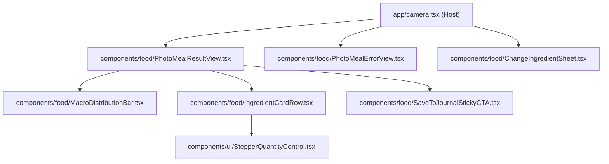

# GETFLOW PHOTO AI EXPERIENCE 2.0 — REFINED OPTION A SPECIFICATION
## "ATHLETIC PRO HUD" WITH FAST INLINE INGREDIENT EDITING & RETRY ARCHITECTURE

**Platform:** Android (React Native / Expo edge-to-edge)  
**Target Hardware:** Samsung Galaxy S24 Ultra (Android 16 / One UI 8.0, 120Hz display)  
**Design Standards:** Apple Human Interface Guidelines (`apple-design`) & SwiftUI Craft (`swiftui-design-skill`) adapted for Android ergonomics and GetFlow dark theme.  
**Primary Color Tokens:** Base `#090C0E`, Surface `#12161A`, Neon Lime `#CCFF00`, Emerald `#10B981`, Amber `#FB923C`, Border `rgba(255,255,255,0.08)`.

---

## 1. Core Architecture & UX Refinements

Based on the owner's explicit direction, **Option A — Athletic Pro HUD** is confirmed as the foundation. The key enhancements focus on high-speed, intuitive ingredient and portion adjustment:

### 1.1 In-Context Quantity Steppers (`-` / `+` 48dp)
- Every ingredient card includes accessible `-` and `+` touch buttons (minimum 48×48 dp touch target).
- Tapping `-` decrements by 25g (clamped to min 1g).
- Tapping `+` increments by 25g (clamped to max 5000g).
- Subtle light haptic feedback on each tick (`Haptics.impactAsync(Light)`).

### 1.2 Tap-to-Type Numeric Chip
- Tapping directly on the gram chip (e.g. `[180g]`) focuses an inline numeric keypad.
- Allows entering an exact gram value immediately without opening any modal dialog.

### 1.3 Discreet "Schimbă" (Change) Bottom Sheet
- Each ingredient has a discreet, subtle "Schimbă" (Change) text button.
- Tapping it slides up a lightweight, frosted dark bottom sheet with a search bar: *"Caută aliment sau ingredient..."*.
- Live query against canonical food database/presets.
- Tapping an item replaces the recognized ingredient and instantly recalculates nutrition using the current gram weight.
- **Zero navigation away and zero repeated Photo AI provider calls.**

### 1.4 Instant Recalculation Engine
- Whenever any gram quantity or ingredient changes, total calories, protein, carbs, fats, and fiber recalculate **synchronously in memory**:
  $$\text{Calories} = \sum \frac{\text{calorii\_per\_100g} \times \text{grame}}{100}$$
- The horizontal macro distribution bar animates with smooth layout transitions to reflect the new ratio.
- Values are clamped to database limits (`calorii` $\le 10000$, `proteine` $\le 1000$, etc.).

### 1.5 100% Resilient Save Failure Recovery
- If saving to Supabase fails (network drop, timeout, or RLS error):
  - A non-blocking amber card appears at the top: *"Salvarea a eșuat. Conexiunea a fost întreruptă. Mâncarea și modificările tale sunt păstrate intacte."*
  - **All recognized foods, user edits, and portion adjustments are 100% PRESERVED in memory and local draft.**
  - The primary CTA button switches to: **"Reîncearcă salvarea • {kcal} kcal"** with a refresh icon.
  - A secondary link allows saving directly to the offline SQLite queue.
  - **No duplicate Flow Credit is deducted.**

---

## 2. Visual Previews (Android Runtime Scale)

````carousel

<!-- slide -->

<!-- slide -->

<!-- slide -->

````

---

## 3. Component Hierarchy & File Mapping



1. **`PhotoMealResultView.tsx`**: Modular container for the entire Option A review screen.
2. **`MacroDistributionBar.tsx`**: 4-segment proportional bar with Protein emerald (`#10B981`), Carbs cyan (`#00F0FF`), Fats orange (`#FB923C`), and Fiber white (`#FFFFFF`).
3. **`IngredientCardRow.tsx`**: Individual item card with thumbnail/icon, name, kcal, macro subtitle, `-` / `+` 48dp steppers, tap-to-type chip, "Schimbă" action, and delete trash icon.
4. **`ChangeIngredientSheet.tsx`**: Search bottom sheet with instant query, macro breakdown preview, and one-tap replacement.
5. **`PhotoMealErrorView.tsx`**: Unified error handler for States A through H (Non-food, network error, timeout, save failure).
