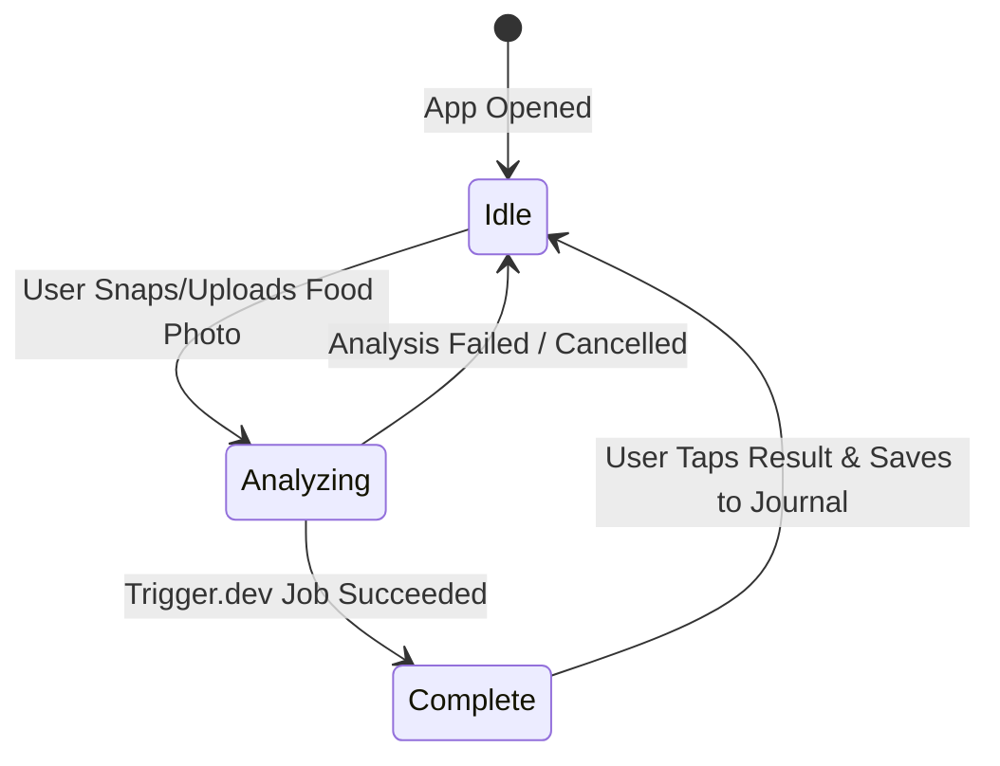

# GETFLOW — RUNNER SPHERE & COMPANION VISUAL REFERENCE DESIGN

**Project:** GetFlow (`com.totsrl.getflo`)  
**Task:** Visual Design Review, Responsive Proportions, and Implementation Planning  
**Mode:** **DESIGN FIRST — NO IMPLEMENTATION YET (Pending Owner Approval)**  
**Consulted UI Policies:** `apple-design` & `swiftui-design-skill` (Adapted to React Native Android, Flow Dark Theme `#090C0E`, `#CCFF00` Lime accents)  
**Primary Reference Authority:** Owner-provided concept board `HOME TOP BAR — REFINED CONCEPT`

---

## 1. VISUAL REFERENCE COMPARISON & PRODUCED ASSETS

### 1.1 Sphere Close-Up (Metal + Glass Depth, Engraved Lines, Orbital Lime Rings)


### 1.2 Android Home Top Bar In-Context Integration Mockup


---

## 2. DESIGN AUTHORITY & CONCEPT TRANSLATION

The owner's design authority establishes a bold, energetic signature element for the GetFlow Home screen, blending:
1. **The Steel Ball Run Dynamic Aesthetic:** High-polish chrome steel and curved crystal glass sphere with engraved rotational lines, expressing forward momentum and athletic energy.
2. **Inner Runner Core:** A high-contrast neon-lime (`#CCFF00`) running athlete silhouette positioned inside the translucent core of the sphere.
3. **Orbital Energy Rings & Progress Dot:** Luminous orbital rings revolving around the sphere, equipped with a leading progress dot that dynamically indicates active processing.
4. **Micro Pixel Companion:** A charming, sprout-like pixel mascot (approx. 32×32dp) with an unobtrusive `Lv 4` level pill that complements—rather than competes with—the runner sphere.
5. **Unified Utility & Functional State:** The sphere serves as the permanent anchor for the **Photo AI State Machine** (Idle → Analyzing → Complete).

---

## 3. EXISTING APPLICATION AUDIT & PRESERVATION GUARANTEE

The proposed design **strictly preserves** all existing functional components and layout geometry on Home:

| Existing Component | Current Implementation | Status in Refined Design |
| :--- | :--- | :--- |
| **Calorie Ring** | `RingProgress` (52dp radius, SVG animated dash) | **PRESERVED 100%** (Sits directly below the header) |
| **Flow Credits Pill** | `FlowCreditsPill` (`FLOW 4 ★` dark pill) | **PRESERVED 100%** (Remains in right header cluster) |
| **Notification Bell** | `Bell` with unread red badge (`/notificari`) | **PRESERVED 100%** (Remains in right header cluster) |
| **Streak Badge** | `streakBadge` (`🔥 0 days` gradient pill) | **PRESERVED 100%** (Remains in right header cluster) |
| **Home Navigation** | Bottom tab bar, sheets, modals | **PRESERVED 100%** (Zero routing or navigation changes) |
| **Translations** | RO / EN / FR / DE in `i18n/locales` | **PRESERVED 100%** (All state descriptions fully localized) |

---

## 4. ANDROID DIMENSIONS & RESPONSIVE FEASIBILITY

### 4.1 Viewport Budget Analysis (Compact Android 360dp vs Standard 412dp)
On modern Android devices (e.g., Samsung Galaxy S24 Ultra at 412dp density width; compact devices at 360dp width):

```text
[ Available Screen Width: 360dp – 412dp ]
├── Horizontal Screen Padding: 20dp left + 20dp right = 40dp
└── Usable Top Bar Width: 320dp (compact) to 372dp (Samsung S24 Ultra)

[ Right Header Group ]
├── FlowCreditsPill: ~72dp
├── Notification Bell: 44dp
├── Streak Pill: ~76dp
└── Inner Gaps (2 × 8dp): 16dp
Total Right Width = ~208dp

[ Left Header Group — Proposed Runner Sphere + Companion ]
├── Runner Sphere Diameter: 44dp (Exact 44×44pt touch target per Apple HIG)
├── Inner Gap: 6dp
├── Micro Companion: 32dp wide × 32dp high
└── Level Pill: Floating 14dp height badge beside/above companion
Total Left Width = 44 + 6 + 32 = 82dp

[ Total Required Top Bar Width ]
82dp (Left) + 208dp (Right) + 24dp (Center Breathing Space) = 314dp <= 320dp!
```

**Verdict:** The runner sphere and companion fit **comfortably on a single non-wrapping row** even on the narrowest 360dp Android devices, with 24–76dp of clean whitespace separating the left and right groups.

### 4.2 Runner Readability at Runtime Size (44dp)
- The outer metallic ring occupies 44dp.
- The inner optical lens has a 30dp clear aperture.
- Within this 30dp aperture, a bold neon-lime vector running silhouette spans 20×20dp, providing **crisp, instant iconographic legibility** on high-density AMOLED screens (505 ppi on Samsung S24 Ultra) without blurring into visual noise.

---

## 5. ANIMATION STORYBOARD & PHOTO AI STATE MACHINE



### 1. State 1 — IDLE (Ready)
- **Visuals:** Runner silhouette rests glowing inside the sphere. The outer lime energy ring has a subtle, slow orbital spin (4.0s loop).
- **Companion:** Micro companion executes a gentle breathing bobbing animation (±1.5px vertical offset every 2.0s).
- **Interaction:** Tapping the sphere or companion opens the Flow Companion / Level status sheet or triggers camera quick-launch.

### 2. State 2 — ANALYZING (In Progress)
- **Visuals:** The runner silhouette dissolves via crossfade into an energetic high-speed scanning beam / rotating orbital energy core. The outer neon progress dot accelerates (1.2s revolution), projecting subtle light trails.
- **Companion:** Companion transitions to "Walking / Supporting" mode (cheerful alternating foot tilt + tiny ambient energy particles).
- **Interaction:** Tapping displays the active Photo AI progress bottom sheet (showing backend step and elapsed time).

### 3. State 3 — COMPLETE (Result Ready)
- **Visuals:** The rotating core smoothly locks and resolves into a glowing neon lime checkmark (`✓`). The energy rings expand slightly with a gentle pulse effect.
- **Companion:** Companion enters "Excited / Complete" mode with an enthusiastic hop and 3 floating star sparkles.
- **Interaction:** Tapping the sphere or companion **instantly opens the meal review / ingredient editor** to inspect the detected macros and save to Journal.

---

## 6. TECHNICAL ARCHITECTURE (NO HEAVY 3D ENGINE)

### Why We Reject a Heavy 3D Engine (Three.js / Expo GL / Filament):
1. **Bundle Bloat:** Adding a WebGL 3D runtime adds 10–25MB to the Android APK/AAB bundle.
2. **Cold Start Latency:** Initializing an OpenGL context on the Home screen increases time-to-interactive (TTI) by 400–800ms.
3. **Battery & Thermals:** Continuous 3D shader evaluation keeps the mobile GPU in high-power state, draining battery during passive dashboard viewing.

### The Superior Native Lightweight Architecture:
We construct the visual depth using **Layered Native Compositing** with **React Native Reanimated + SVG + Pre-rendered High-Res Optical Sprites**:

```text
┌────────────────────────────────────────────────────────┐
│ Layer 4: Specular Glass Reflection (High-Gloss Curved Glare Overlay) │
├────────────────────────────────────────────────────────┤
│ Layer 3: Reanimated Orbital Energy Rings & Progress Dot (SVG Canvas)  │
├────────────────────────────────────────────────────────┤
│ Layer 2: Core State Icon (Vector Runner 🏃 / Core ⚡ / Checkmark ✓)   │
├────────────────────────────────────────────────────────┤
│ Layer 1: Metal-Engraved Base Sphere (Ultra-Crisp 15KB WebP Asset)    │
└────────────────────────────────────────────────────────┘
```

1. **Layer 1 (Base Sphere):** Pre-rendered 128×128 WebP graphic created from the approved concept, providing authentic brushed steel, engraved bevels, and radial shadows with zero runtime GPU math.
2. **Layer 2 (Core Icon):** Sharp SVG vector silhouette animated with Reanimated `withTiming` opacity/scale transitions.
3. **Layer 3 (Orbital Ring):** SVG path with stroke dash and an animated lime particle dot revolving via Reanimated `rotation.value = withRepeat(withTiming(360, { duration: 4000, easing: Easing.linear }), -1)` directly on the UI thread.
4. **Layer 4 (Glass Cap):** Translucent gradient reflection overlay creating realistic spherical refraction.
5. **Reduced Motion Compliance:** When `useReducedMotion()` is true, continuous rotation is completely disabled. The ring and dot remain locked at a static 45° beauty angle, and state transitions use immediate opacity crossfades.

---

## 7. EXPECTED PERFORMANCE & RESOURCE COST

| Metric | Proposed Native Layered Compositing | Heavy 3D Engine (Rejected) |
| :--- | :--- | :--- |
| **Frame Rate** | **Rock-Solid 60 FPS / 120Hz** (Native UI Thread) | 45–55 FPS on mid-range Android |
| **CPU Utilization** | **< 0.5%** | 8% – 15% continuous |
| **Memory Footprint** | **~1.8 MB** (Asset textures + display list) | 45 MB – 85 MB |
| **APK Size Impact** | **< 40 KB** (Pre-rendered asset + SVG code) | +12 MB – 25 MB |
| **Battery Impact** | **Negligible** | High (prevents GPU low-power sleep) |

---

## 8. OWNER APPROVAL & NEXT STEPS

> [!IMPORTANT]
> **Owner Review & Design Sign-Off:**  
> This proposal presents the visual reference design, Android header integration, 3-state animation storyboard, and lightweight native implementation plan.  
> In accordance with instructions, **no implementation code, branch merges, or Android builds will take place until you explicitly approve this design.**  
>  
> Please confirm if you approve this visual direction and technical architecture so we can proceed to implementation planning.
